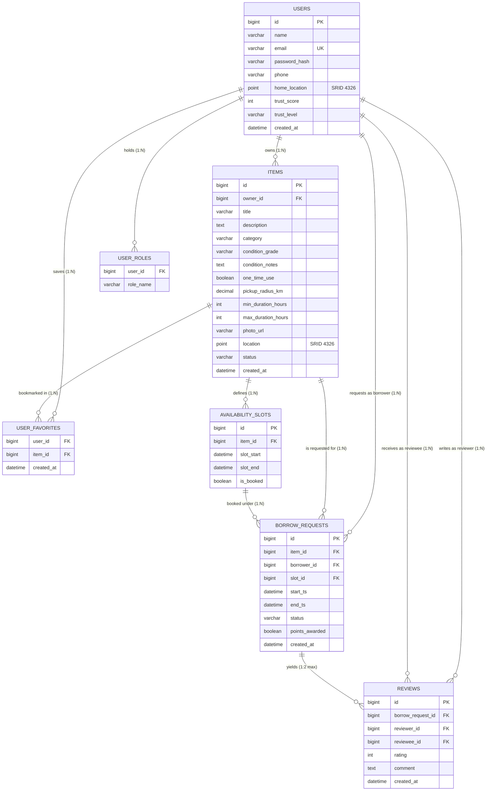
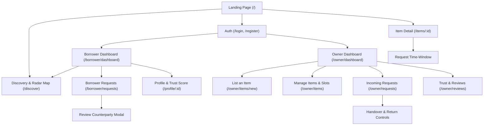
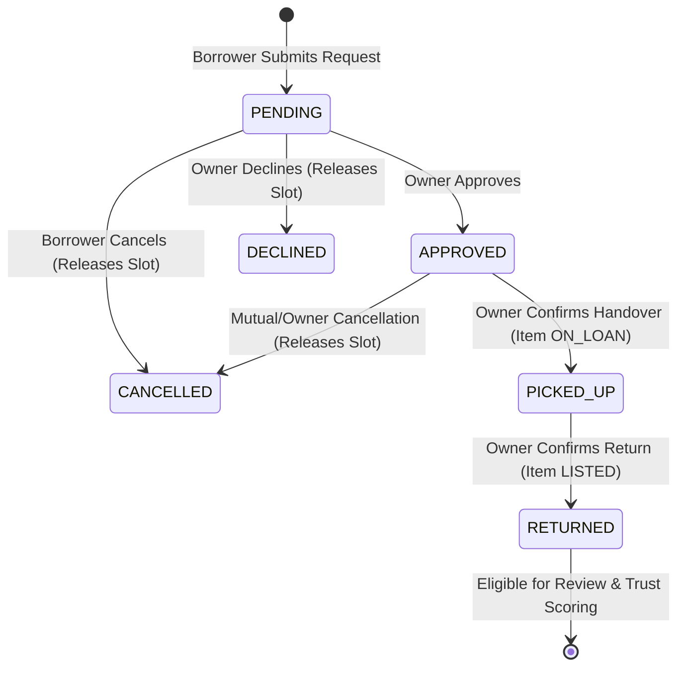
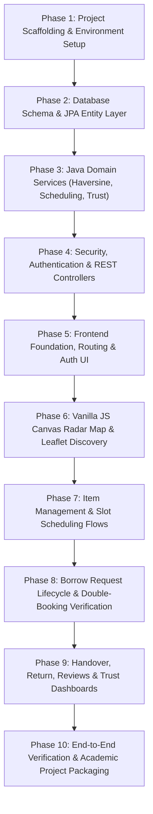

# TOOLBARTER: Hyper-Local One-Time-Use Tool Barter
## Comprehensive Project Plan & Architecture Blueprint

**Academic Project:** B.Tech CSE Full-Stack Capstone Project  
**Candidate Name:** Ch. Rithwik  
**Roll No.:** 24EG105P07  
**Branch & Section:** Computer Science and Engineering (CSE)  
**Document Status:** Final Architecture & Engineering Plan (Pre-Implementation Phase)  
**Target Delivery Stack:** 
- **Backend:** Java 17/21, Spring Boot 3.x, Spring Data JPA / Hibernate Spatial, Spring Security, Maven
- **Database:** MySQL 8.0+ with Spatial Data Types (`POINT SRID 4326`, `SPATIAL INDEX`)
- **Frontend:** React.js 18+ (JavaScript), Vite, Leaflet.js, Vanilla JS HTML5 Canvas Radar Map

---

## 1. Executive Summary & Project Core Proposition

### 1.1 Project Overview
**TOOLBARTER** ("Borrow Nearby. Build Together.") is a hyper-local peer-to-peer tool lending and geo-discovery marketplace. The platform solves the fundamental inefficiency where home and garden tools (power washers, tall extension ladders, tile cutters, paint sprayers) are needed for brief durations (a few hours or a weekend) but sit idle in neighbouring garages without a trusted, discoverable, and schedulable exchange mechanism.

### 1.2 Core Architectural Axioms
1. **Zero Hardcoded Metrics:** Every distance displayed, every booked time-window, every dashboard summary, and every user trust score is computed dynamically by backend services backed by persistent MySQL spatial records.
2. **Strict Layered Request Flow:** A web request never bypasses the service and persistence layers:
   $$\text{React UI} \longrightarrow \text{REST API Controller} \longrightarrow \text{Java Service Layer} \longrightarrow \text{Spring Data JPA Repository} \longrightarrow \text{MySQL Spatial}$$
3. **Java Service-Layer Authority:** Heavy domain logic—specifically Haversine great-circle distance calculations, temporal double-booking overlap validations, and trust score/level re-evaluations—is implemented strictly within Java service classes rather than in React state or database triggers.
4. **Decoupled Radar Visualization:** The high-density proximity radar map is rendered using a Vanilla JS HTML5 Canvas / Leaflet.js layer that intentionally sits outside React's virtual-DOM reconciliation cycle to handle smooth real-time redrawing of hundreds of nearby markers without re-render performance bottlenecks.

---

## 2. Explicit Ambiguities in Abstract & Technical Resolutions

To adhere strictly to the project specification while ensuring seamless implementation, the following ambiguities identified in the abstract document are resolved:

| # | Abstract Ambiguity | PDF Cross-Reference | Engineering Resolution |
|---|--------------------|---------------------|------------------------|
| **1** | **Pickup & Return Confirmation:** Section 6.1 states pickup/return are "confirmed by both parties", while Section 13 states "Only OWNER confirms pickup/return". | Sec 6.1 vs Sec 13 | **Owner-Authorized State Transition with Mutual Acknowledgement:** The authoritative API actions (`PUT /api/requests/{id}/pickup` and `PUT /api/requests/{id}/return`) are restricted to the **Owner** (the custodian of physical inventory), while the borrower UI displays an exchange checklist / handover acknowledgement. This prevents malicious borrower self-pickup claims while preserving owner control. |
| **2** | **Geocoding Home Location at Registration:** Section 4 & 13 specify "geocoded home location", but do not specify whether geocoding happens client-side or server-side. | Sec 4, Sec 13 | **Hybrid Ingestion with Leaflet Map Picker:** The React registration form provides both an address input and an interactive Leaflet map pin-drop to capture exact `(latitude, longitude)`. The backend validates coordinate ranges (Latitude $\in [-90, 90]$, Longitude $\in [-180, 180]$) and stores the geometry as `ST_PointFromText('POINT(lng lat)', 4326)` in MySQL. |
| **3** | **Dual Roles (`OWNER` vs `BORROWER`):** Section 4 states "The only roles are OWNER and BORROWER, and a single account may act as both." | Sec 4, Sec 11.1 | **Multi-Role Assignment:** Users have an `enum` set or join table `user_roles` holding `ROLE_OWNER`, `ROLE_BORROWER`, or both. Navigation and dashboard components conditionally show Owner and Borrower consoles based on the active role profile without requiring separate accounts. |
| **4** | **Availability Slots vs. Borrow Time-Windows:** Section 5.1 specifies availability slots, while Section 6.1 states borrowers submit start/end timestamps within slots. | Sec 5.1, Sec 6.1, Sec 14 | **Slot-Contained Booking with Slot Locking:** An owner defines broad availability slots (`slot_start` to `slot_end`). When a borrower requests a window (`start_ts` to `end_ts`), it must fall within the open slot (`slot_start <= start_ts < end_ts <= slot_end`). Upon owner approval, the slot is locked (`is_booked = true`), and the item's schedule is blocked against overlapping approved/picked-up windows. |
| **5** | **Trust Score Deduction Quantities:** Section 6.3 notes that "a late or disputed return subtracts points", but does not define explicit deduction values. | Sec 6.3 | **Deterministic Point Penalties:** Base completion: `+5 pts`; 5-star review: `+2 pts`; 4-star review: `+1 pt`; 3-star review: `0 pts`; 2-star review: `-2 pts`; 1-star review: `-4 pts`; Late return (> 2 hours overdue): `-3 pts`; Dispute flagged by owner/borrower: `-5 pts`. |
| **6** | **Trust Level Point & Exchange Thresholds:** Section 4 & 6.3 define the five ordered levels but omit exact cutoff criteria. | Sec 4, Sec 6.3 | **Hierarchical Milestone Thresholds:**<br>1. *New Neighbour:* 0–14 pts or < 2 completed borrows.<br>2. *Regular Borrower:* 15–34 pts and $\ge 2$ completed borrows.<br>3. *Reliable Lender:* 35–64 pts, $\ge 5$ completed borrows, and $\ge 1$ item listed.<br>4. *Trusted Neighbour:* 65–99 pts, $\ge 10$ completed borrows, avg rating $\ge 4.2$.<br>5. *Street Champion:* $\ge 100$ pts, $\ge 20$ completed borrows, avg rating $\ge 4.6$. |
| **7** | **Item Schema Completeness:** Section 5.1 details fields like `one-time-use tag`, `pickup radius`, `photo placeholder`, `min/max borrow duration`, but Section 14 lists a concise version. | Sec 5.1 vs Sec 14 | **Complete Entity Schema:** The MySQL `items` table incorporates all Section 5.1 requirements: `pickup_radius_km`, `one_time_use` (BOOLEAN), `condition_notes`, `photo_url`, `min_duration_hours`, and `max_duration_hours`. |
| **8** | **Saved / Favourite Items Persistence:** Section 6.4 includes "saved/favourite items" on Borrower Dashboard, but Section 14 omits a table. | Sec 6.4, Sec 14 | **Dedicated `user_favorites` Table:** Added a normalized relationship table `user_favorites (user_id FK, item_id FK, created_at)` to support live dynamic queries for saved items without hardcoding. |

---

## 3. Functional Requirements Checklist

### 3.1 Authentication & User Management
- [ ] User registration with Full Name, Email, Password, Phone Number, Home Location (`latitude`, `longitude`), and initial Role selection (`OWNER`, `BORROWER`, or dual).
- [ ] Unique email constraint enforcement with field-level Bean Validation.
- [ ] Secure password hashing using BCrypt (work factor 10+) before persistence.
- [ ] JWT-based or Session-based authentication returning user profile, roles, and authorization tokens.
- [ ] Profile retrieval (`GET /api/users/{id}`) displaying personal details, home location, current trust score, trust level, and summary metrics.
- [ ] Profile update (`PUT /api/users/{id}`) for contact information and location updates.
- [ ] User statistics endpoint (`GET /api/users/{id}/statistics`) computing live metrics: items listed, items borrowed, completed exchanges, active loans, and recent activity.

### 3.2 Item Management (Owner)
- [ ] Create item listing (`POST /api/items`) specifying Title, Description, Category, Condition Notes, One-Time-Use tag, Location coordinates, Pickup Radius, Min/Max borrow duration, and Photo URL/placeholder.
- [ ] Restrict item creation and modification strictly to users possessing the `OWNER` role.
- [ ] Edit item listing (`PUT /api/items/{id}`) with ownership authorization validation.
- [ ] Delete or unlist item (`DELETE /api/items/{id}`) with safety checks preventing deletion if active loans or approved requests exist.
- [ ] Enforce valid Category taxonomy:
  - `Power Tools`
  - `Ladders & Access`
  - `Garden & Yard`
  - `Cleaning Equipment`
  - `Painting & Decorating`
  - `Event & Party Gear`
  - `Other`
- [ ] Enforce valid Item Lifecycle statuses:
  - `LISTED`
  - `RESERVED`
  - `ON_LOAN`
  - `RETURNED`
  - `UNAVAILABLE`

### 3.3 Availability Slot Management (Owner)
- [ ] Define item availability slots (`POST /api/items/{itemId}/slots`) with `slot_start` and `slot_end` timestamps.
- [ ] Retrieve open slots for an item (`GET /api/items/{itemId}/slots`).
- [ ] Prevent creation of inverted or overlapping slots for the same item (`slot_start < slot_end`).
- [ ] Mark slots as booked (`is_booked = true`) upon request approval and release upon cancellation/decline.

### 3.4 Tool Discovery & Spatial Radar Map (Borrower)
- [ ] List items with keyword search on title/category, category filtering, and date filtering (`GET /api/items`).
- [ ] Proximity search endpoint (`GET /api/items/nearby?lat={lat}&lng={lng}&radius={km}`) executing Haversine distance ranking in Java.
- [ ] Item details view (`GET /api/items/{id}`) returning description, condition, owner details, open availability slots, distance relative to current user, and recent reviews.
- [ ] High-performance Vanilla JS HTML5 Canvas / Leaflet.js radar map rendering hundreds of nearby items with smooth rendering outside React virtual-DOM.

### 3.5 Borrow Request & Double-Booking Prevention
- [ ] Submit borrow request (`POST /api/items/{itemId}/requests`) selecting an open slot and target time-window (`start_ts`, `end_ts`).
- [ ] Double-booking check in Java service layer rejecting overlapping windows against any existing `APPROVED` or `PICKED_UP` request for the same tool.
- [ ] Owner approval endpoint (`PUT /api/requests/{id}/approve`) transitioning status from `PENDING` to `APPROVED` and locking the associated slot.
- [ ] Owner decline endpoint (`PUT /api/requests/{id}/decline`) transitioning status to `DECLINED` and unlocking the slot.
- [ ] Borrower cancellation endpoint (`PUT /api/requests/{id}/cancel`) releasing slot reservation.
- [ ] Handover pickup confirmation (`PUT /api/requests/{id}/pickup`) by owner transitioning request to `PICKED_UP` and item to `ON_LOAN`.
- [ ] Return confirmation (`PUT /api/requests/{id}/return`) by owner transitioning request to `RETURNED` and item to `RETURNED`/`LISTED`.

### 3.6 Trust-Based Reviews & Ratings
- [ ] Submit review endpoint (`POST /api/requests/{id}/review`) linking directly to a completed `RETURNED` borrow record.
- [ ] Enforce reciprocal review constraint: both owner and borrower may submit at most **one** review per borrow exchange.
- [ ] Collect 1–5 star integer rating and optional free-text comments (condition, punctuality, communication).
- [ ] Retrieve user reviews (`GET /api/users/{id}/reviews`) showing reviews received as an owner and as a borrower.

### 3.7 Rule-Based Trust Scoring & Level Engine
- [ ] Recalculate trust score immediately following borrow return and review submission.
- [ ] Enforce the **one-contribution rule**: prevent any borrow record from awarding points more than once.
- [ ] Award `+5` points for completed undisputed borrow; award `+2` points for each 5-star review.
- [ ] Deduct points for late return or disputed exchange.
- [ ] Recalculate trust level automatically:
  $$\text{New Neighbour} \longrightarrow \text{Regular Borrower} \longrightarrow \text{Reliable Lender} \longrightarrow \text{Trusted Neighbour} \longrightarrow \text{Street Champion}$$
- [ ] Enforce integrity principle: pending, declined, or disputed requests never inflate trust scores, levels, or community totals.

### 3.8 Role Dashboards & Neighbourhood Impact
- [ ] **Borrower Dashboard:** Dynamic metrics for items borrowed, active requests, trust score, current level, upcoming pickups, recent activity, nearby tools map, and saved items.
- [ ] **Owner Dashboard:** Dynamic metrics for items listed, active loans, pending approval count, reviews received, item utilisation rates, return punctuality percentage, and owner trust score.
- [ ] **Landing Page Community Impact:** Aggregate platform statistics: total items listed, completed exchanges, estimated distance saved (km), and community average trust score.

---

## 4. Database Schema & Relational Design (MySQL Spatial)

The database schema utilizes MySQL 8.0 spatial extensions with the World Geodetic System 1984 (`SRID 4326`) projection.



### 4.1 Table Specifications and DDL

#### Table: `users`
Represents platform members acting as owners, borrowers, or both.
```sql
CREATE TABLE users (
    id BIGINT AUTO_INCREMENT PRIMARY KEY,
    name VARCHAR(100) NOT NULL,
    email VARCHAR(150) NOT NULL UNIQUE,
    password_hash VARCHAR(255) NOT NULL,
    phone VARCHAR(20) NOT NULL,
    home_location POINT NOT NULL SRID 4326,
    trust_score INT NOT NULL DEFAULT 0,
    trust_level VARCHAR(30) NOT NULL DEFAULT 'NEW_NEIGHBOUR',
    created_at TIMESTAMP NOT NULL DEFAULT CURRENT_TIMESTAMP,
    SPATIAL INDEX idx_users_home_location (home_location)
) ENGINE=InnoDB DEFAULT CHARSET=utf8mb4 COLLATE=utf8mb4_unicode_ci;
```

#### Table: `user_roles`
Allows a single user account to possess both `ROLE_OWNER` and `ROLE_BORROWER`.
```sql
CREATE TABLE user_roles (
    user_id BIGINT NOT NULL,
    role_name VARCHAR(30) NOT NULL,
    PRIMARY KEY (user_id, role_name),
    CONSTRAINT fk_user_roles_user FOREIGN KEY (user_id) REFERENCES users(id) ON DELETE CASCADE
) ENGINE=InnoDB DEFAULT CHARSET=utf8mb4 COLLATE=utf8mb4_unicode_ci;
```

#### Table: `items`
Catalog of tools listed by owners with spatial coordinates and condition details.
```sql
CREATE TABLE items (
    id BIGINT AUTO_INCREMENT PRIMARY KEY,
    owner_id BIGINT NOT NULL,
    title VARCHAR(150) NOT NULL,
    description TEXT NOT NULL,
    category VARCHAR(50) NOT NULL,
    condition_grade VARCHAR(50) NOT NULL,
    condition_notes TEXT,
    one_time_use BOOLEAN NOT NULL DEFAULT FALSE,
    pickup_radius_km DECIMAL(6,2) NOT NULL DEFAULT 5.00,
    min_duration_hours INT NOT NULL DEFAULT 1,
    max_duration_hours INT NOT NULL DEFAULT 72,
    photo_url VARCHAR(500),
    location POINT NOT NULL SRID 4326,
    status VARCHAR(30) NOT NULL DEFAULT 'LISTED',
    created_at TIMESTAMP NOT NULL DEFAULT CURRENT_TIMESTAMP,
    CONSTRAINT fk_items_owner FOREIGN KEY (owner_id) REFERENCES users(id) ON DELETE RESTRICT,
    SPATIAL INDEX idx_items_location (location),
    INDEX idx_items_category (category),
    INDEX idx_items_status (status)
) ENGINE=InnoDB DEFAULT CHARSET=utf8mb4 COLLATE=utf8mb4_unicode_ci;
```

#### Table: `availability_slots`
Owner-defined scheduled windows during which an item can be borrowed.
```sql
CREATE TABLE availability_slots (
    id BIGINT AUTO_INCREMENT PRIMARY KEY,
    item_id BIGINT NOT NULL,
    slot_start DATETIME NOT NULL,
    slot_end DATETIME NOT NULL,
    is_booked BOOLEAN NOT NULL DEFAULT FALSE,
    CONSTRAINT fk_slots_item FOREIGN KEY (item_id) REFERENCES items(id) ON DELETE CASCADE,
    INDEX idx_slots_item_time (item_id, slot_start, slot_end)
) ENGINE=InnoDB DEFAULT CHARSET=utf8mb4 COLLATE=utf8mb4_unicode_ci;
```

#### Table: `borrow_requests`
Verifiable scheduled loan agreements between borrowers and items.
```sql
CREATE TABLE borrow_requests (
    id BIGINT AUTO_INCREMENT PRIMARY KEY,
    item_id BIGINT NOT NULL,
    borrower_id BIGINT NOT NULL,
    slot_id BIGINT NOT NULL,
    start_ts DATETIME NOT NULL,
    end_ts DATETIME NOT NULL,
    status VARCHAR(30) NOT NULL DEFAULT 'PENDING',
    points_awarded BOOLEAN NOT NULL DEFAULT FALSE,
    pickup_confirmed_at DATETIME NULL,
    return_confirmed_at DATETIME NULL,
    created_at TIMESTAMP NOT NULL DEFAULT CURRENT_TIMESTAMP,
    CONSTRAINT fk_requests_item FOREIGN KEY (item_id) REFERENCES items(id) ON DELETE RESTRICT,
    CONSTRAINT fk_requests_borrower FOREIGN KEY (borrower_id) REFERENCES users(id) ON DELETE RESTRICT,
    CONSTRAINT fk_requests_slot FOREIGN KEY (slot_id) REFERENCES availability_slots(id) ON DELETE RESTRICT,
    INDEX idx_requests_item_status (item_id, status),
    INDEX idx_requests_borrower (borrower_id)
) ENGINE=InnoDB DEFAULT CHARSET=utf8mb4 COLLATE=utf8mb4_unicode_ci;
```

#### Table: `reviews`
Post-exchange bilateral ratings and feedback linked to completed borrow records.
```sql
CREATE TABLE reviews (
    id BIGINT AUTO_INCREMENT PRIMARY KEY,
    borrow_request_id BIGINT NOT NULL,
    reviewer_id BIGINT NOT NULL,
    reviewee_id BIGINT NOT NULL,
    rating INT NOT NULL,
    comment TEXT,
    created_at TIMESTAMP NOT NULL DEFAULT CURRENT_TIMESTAMP,
    CONSTRAINT fk_reviews_request FOREIGN KEY (borrow_request_id) REFERENCES borrow_requests(id) ON DELETE CASCADE,
    CONSTRAINT fk_reviews_reviewer FOREIGN KEY (reviewer_id) REFERENCES users(id) ON DELETE RESTRICT,
    CONSTRAINT fk_reviews_reviewee FOREIGN KEY (reviewee_id) REFERENCES users(id) ON DELETE RESTRICT,
    CONSTRAINT uq_request_reviewer UNIQUE (borrow_request_id, reviewer_id),
    CHECK (rating >= 1 AND rating <= 5)
) ENGINE=InnoDB DEFAULT CHARSET=utf8mb4 COLLATE=utf8mb4_unicode_ci;
```

#### Table: `user_favorites`
Enables borrowers to bookmark items for fast retrieval on their dashboard.
```sql
CREATE TABLE user_favorites (
    user_id BIGINT NOT NULL,
    item_id BIGINT NOT NULL,
    created_at TIMESTAMP NOT NULL DEFAULT CURRENT_TIMESTAMP,
    PRIMARY KEY (user_id, item_id),
    CONSTRAINT fk_favorites_user FOREIGN KEY (user_id) REFERENCES users(id) ON DELETE CASCADE,
    CONSTRAINT fk_favorites_item FOREIGN KEY (item_id) REFERENCES items(id) ON DELETE CASCADE
) ENGINE=InnoDB DEFAULT CHARSET=utf8mb4 COLLATE=utf8mb4_unicode_ci;
```

---

## 5. Backend Package Structure (Maven)

The backend follows the clean layered architecture mandated in Section 12 of the abstract.

```
com.toolbarter/
├── ToolbarterApplication.java
├── config/
│   ├── SecurityConfig.java
│   ├── JwtAuthenticationFilter.java
│   ├── JwtTokenProvider.java
│   ├── JacksonConfig.java          # GeoJSON / JTS Spatial serializer
│   └── WebMvcConfig.java           # CORS and interceptor configuration
├── controller/
│   ├── AuthController.java
│   ├── UserController.java
│   ├── ItemController.java
│   ├── SlotController.java
│   ├── RequestController.java
│   ├── ReviewController.java
│   └── PublicImpactController.java
├── service/
│   ├── AuthService.java
│   ├── UserService.java
│   ├── ItemService.java
│   ├── GeoProximityService.java
│   ├── SchedulingService.java
│   ├── TrustService.java
│   └── impl/
│       ├── AuthServiceImpl.java
│       ├── UserServiceImpl.java
│       ├── ItemServiceImpl.java
│       ├── GeoProximityServiceImpl.java
│       ├── SchedulingServiceImpl.java
│       └── TrustServiceImpl.java
├── repository/
│   ├── UserRepository.java
│   ├── ItemRepository.java
│   ├── SlotRepository.java
│   ├── BorrowRequestRepository.java
│   ├── ReviewRepository.java
│   └── UserFavoriteRepository.java
├── entity/
│   ├── User.java
│   ├── Item.java
│   ├── AvailabilitySlot.java
│   ├── BorrowRequest.java
│   ├── Review.java
│   └── enums/
│       ├── ItemCategory.java
│       ├── ItemStatus.java
│       ├── BorrowStatus.java
│       ├── TrustLevel.java
│       └── RoleType.java
├── dto/
│   ├── request/
│   │   ├── RegisterRequest.java
│   │   ├── LoginRequest.java
│   │   ├── UserUpdateRequest.java
│   │   ├── ItemCreateRequest.java
│   │   ├── ItemUpdateRequest.java
│   │   ├── SlotCreateRequest.java
│   │   ├── BorrowCreateRequest.java
│   │   └── ReviewCreateRequest.java
│   └── response/
│       ├── AuthResponse.java
│       ├── UserProfileResponse.java
│       ├── UserStatisticsResponse.java
│       ├── ItemSummaryResponse.java
│       ├── ItemDetailResponse.java
│       ├── NearbyItemResponse.java
│       ├── SlotResponse.java
│       ├── BorrowRequestResponse.java
│       ├── ReviewResponse.java
│       ├── CommunityImpactResponse.java
│       └── ApiErrorResponse.java
└── exception/
    ├── ResourceNotFoundException.java
    ├── DuplicateEmailException.java
    ├── UnauthorizedOperationException.java
    ├── SlotConflictException.java
    ├── InvalidLifecycleTransitionException.java
    ├── ReviewNotAllowedException.java
    └── GlobalExceptionHandler.java
```

### 5.1 Maven Dependency Stack (`pom.xml`)
- `org.springframework.boot:spring-boot-starter-web`
- `org.springframework.boot:spring-boot-starter-data-jpa`
- `org.springframework.boot:spring-boot-starter-security`
- `org.springframework.boot:spring-boot-starter-validation`
- `com.mysql:mysql-connector-j`
- `org.hibernate.orm:hibernate-spatial` (Hibernate Spatial 6.x supporting JTS Geometry)
- `org.locationtech.jts:jts-core:1.19.0`
- `io.jsonwebtoken:jjwt-api:0.12.5` (plus `jjwt-impl` and `jjwt-jackson`)
- `org.projectlombok:lombok` (Optional / Recommended for clean DTOs)
- `org.springframework.boot:spring-boot-starter-test` (JUnit 5, Mockito, AssertJ)

---

## 6. REST API Specification

### 6.1 Authentication Endpoints
| Method | Route | Access | Request Body | Response Body | Description |
|---|---|---|---|---|---|
| `POST` | `/api/auth/register` | Public | `RegisterRequest` (name, email, password, phone, latitude, longitude, roles) | `AuthResponse` (jwt, user summary) | Registers account, validates coordinate ranges, hashes password, saves POINT. |
| `POST` | `/api/auth/login` | Public | `LoginRequest` (email, password) | `AuthResponse` (jwt, user summary) | Authenticates credentials, returns signed JWT. |
| `GET` | `/api/auth/me` | Authenticated | None | `UserProfileResponse` | Retrieves currently authenticated user context. |

### 6.2 User Profile & Statistics Endpoints
| Method | Route | Access | Request Body | Response Body | Description |
|---|---|---|---|---|---|
| `GET` | `/api/users/{id}` | Authenticated | None | `UserProfileResponse` | Fetches user details, home coordinates, trust score, and trust level. |
| `PUT` | `/api/users/{id}` | Self / Admin | `UserUpdateRequest` (name, phone, latitude, longitude) | `UserProfileResponse` | Updates personal info and geocoded location. |
| `GET` | `/api/users/{id}/statistics` | Authenticated | None | `UserStatisticsResponse` | Computes live borrower/owner metrics (items listed, loans, score, activity). |
| `GET` | `/api/users/{id}/favorites` | Self | None | `List<ItemSummaryResponse>` | Returns items saved by the borrower. |
| `POST` | `/api/users/{id}/favorites/{itemId}` | Self | None | `Void` | Bookmarks an item into favorites. |
| `DELETE` | `/api/users/{id}/favorites/{itemId}` | Self | None | `Void` | Removes an item from favorites. |

### 6.3 Tool & Item Endpoints
| Method | Route | Access | Request Body / Params | Response Body | Description |
|---|---|---|---|---|---|
| `GET` | `/api/items` | Public | Params: `query`, `category`, `radius`, `lat`, `lng`, `date` | `List<ItemSummaryResponse>` | Searches and filters items with Haversine distance ranking. |
| `GET` | `/api/items/nearby` | Public | Params: `lat` (double), `lng` (double), `radius` (km) | `List<NearbyItemResponse>` | Haversine-ranked proximity result set for the radar map. |
| `GET` | `/api/items/{id}` | Public | None | `ItemDetailResponse` | Details, condition, owner trust score, open slots, distance, reviews. |
| `POST` | `/api/items` | `ROLE_OWNER` | `ItemCreateRequest` (title, description, category, condition, location, etc.) | `ItemDetailResponse` | Creates a new tool record owned by the authenticated user. |
| `PUT` | `/api/items/{id}` | Item Owner | `ItemUpdateRequest` (title, description, category, status, etc.) | `ItemDetailResponse` | Updates listing attributes. Only owner is authorized. |
| `DELETE` | `/api/items/{id}` | Item Owner | None | `Void` | Unlists or deletes item if no active loans exist. |

### 6.4 Availability Slot Endpoints
| Method | Route | Access | Request Body | Response Body | Description |
|---|---|---|---|---|---|
| `POST` | `/api/items/{itemId}/slots` | Item Owner | `SlotCreateRequest` (`slot_start`, `slot_end`) | `SlotResponse` | Defines a bookable time-window for an item. |
| `GET` | `/api/items/{itemId}/slots` | Public | None | `List<SlotResponse>` | Returns open, unbooked slots for an item. |
| `DELETE` | `/api/items/{itemId}/slots/{slotId}` | Item Owner | None | `Void` | Removes an unbooked slot. |

### 6.5 Borrow Request Lifecycle Endpoints
| Method | Route | Access | Request Body | Response Body | Description |
|---|---|---|---|---|---|
| `POST` | `/api/items/{itemId}/requests` | `ROLE_BORROWER` | `BorrowCreateRequest` (`slot_id`, `start_ts`, `end_ts`) | `BorrowRequestResponse` | Submits request; executes Java double-booking check. |
| `PUT` | `/api/requests/{id}/approve` | Item Owner | None | `BorrowRequestResponse` | Approves request (`APPROVED`) and locks slot (`is_booked=true`). |
| `PUT` | `/api/requests/{id}/decline` | Item Owner | None | `BorrowRequestResponse` | Declines request (`DECLINED`) and releases slot. |
| `PUT` | `/api/requests/{id}/cancel` | Borrower | None | `BorrowRequestResponse` | Cancels request (`CANCELLED`) and releases slot. |
| `PUT` | `/api/requests/{id}/pickup` | Item Owner | None | `BorrowRequestResponse` | Confirms handover (`PICKED_UP`), updates item to `ON_LOAN`. |
| `PUT` | `/api/requests/{id}/return` | Item Owner | None | `BorrowRequestResponse` | Confirms return (`RETURNED`), triggers trust score evaluation. |
| `GET` | `/api/requests/borrower` | `ROLE_BORROWER` | None | `List<BorrowRequestResponse>` | Lists requests submitted by current borrower. |
| `GET` | `/api/requests/owner` | `ROLE_OWNER` | None | `List<BorrowRequestResponse>` | Lists requests received across owner's items. |

### 6.6 Review & Rating Endpoints
| Method | Route | Access | Request Body | Response Body | Description |
|---|---|---|---|---|---|
| `POST` | `/api/requests/{id}/review` | Participant | `ReviewCreateRequest` (`rating`, `comment`) | `ReviewResponse` | Submits bilateral review; triggers trust recalculation. |
| `GET` | `/api/users/{id}/reviews` | Public | None | `List<ReviewResponse>` | Lists verified reviews received by the user. |

### 6.7 Platform & Public Statistics Endpoints
| Method | Route | Access | Request Body | Response Body | Description |
|---|---|---|---|---|---|
| `GET` | `/api/public/impact` | Public | None | `CommunityImpactResponse` | Live counts: items listed, exchanges completed, distance saved, avg trust score. |

---

## 7. Frontend Page List & UI Architecture

The frontend is constructed as a React Single Page Application (SPA) with Vite.



### 7.1 Page Catalog & Responsibilities

| Page Name | Route | Authorized Roles | Key Components & Behaviors |
|---|---|---|---|
| **Landing Page** | `/` | Public | - **Hero:** Title, tagline, quick CTA buttons.<br>- **How It Works:** 5-step lifecycle infographic.<br>- **Featured Items:** Live nearby tools fetched from `/api/items`.<br>- **Neighbourhood Impact Panel:** Live totals: items listed, exchanges completed, distance saved, average trust score. |
| **User Registration** | `/register` | Public | Full Name, Email, Password, Phone, Role checkboxes (`OWNER`, `BORROWER`), Interactive Leaflet coordinate pin-picker for home location. |
| **User Login** | `/login` | Public | Email and Password form; redirects to borrower or owner dashboard upon authentication. |
| **Proximity Radar Map & Discovery** | `/discover` | Public / Borrower | - Search bar (title/category) & filters (category, radius slider 1–50 km, date).<br>- **Vanilla JS Canvas Radar View:** High-performance radar sweep rendering hundreds of items without virtual-DOM lag.<br>- **Interactive Leaflet Map View:** Marker clustering, pickup radius circles, and tool popup cards.<br>- Distance-ranked tool grid with live next-available slot and owner trust badge. |
| **Item Detail & Booking** | `/items/:id` | Public / Borrower | Full description, condition notes, photo preview, pickup radius, owner profile badge with trust score and level, open availability slots calendar/picker, request time-window modal with instant backend double-booking validation. |
| **Borrower Dashboard** | `/borrower/dashboard` | `ROLE_BORROWER` | Live summary cards: items borrowed, active requests count, current trust score, trust level badge, upcoming pickups calendar, saved/favorite items shelf, quick mini-map of nearby tools. |
| **Borrower Requests & Ledger** | `/borrower/requests` | `ROLE_BORROWER` | Table and card list of requests (`PENDING`, `APPROVED`, `DECLINED`, `PICKED_UP`, `RETURNED`, `CANCELLED`). Shows pickup handover instructions, return deadlines, and review submission triggers. |
| **Owner Dashboard** | `/owner/dashboard` | `ROLE_OWNER` | Live summary cards: items listed count, active loans, incoming requests pending approval, reviews received, tool utilization rate per item, return punctuality score, overall trust score. |
| **List New Item** | `/owner/items/new` | `ROLE_OWNER` | Tool creation form: title, description, category select, condition grade, condition notes, one-time-use toggle, pickup radius, min/max duration, photo upload/URL, initial availability slot inputs. |
| **Manage Items & Availability Slots** | `/owner/items` | `ROLE_OWNER` | List of owner's tools with live status tags (`LISTED`, `ON_LOAN`, `RESERVED`, `UNAVAILABLE`). Expandable slot manager to add/remove specific bookable time-windows. |
| **Owner Requests & Handover Console** | `/owner/requests` | `ROLE_OWNER` | Incoming borrower requests queue: Approve and Decline actions; Handover confirmation button (`Mark as Picked Up`); Reclaim confirmation button (`Confirm Returned & Review`). |
| **User Profile & Trust Ledger** | `/profile/:id` | Authenticated | User details, geocoded locality, verified trust score, trust level badge, history of completed exchanges, counterparty ratings and feedback comments. |
| **Review & Feedback Modal** | Modal / `/requests/:id/review` | Authenticated | 1–5 star interactive rating selector, free-text feedback for condition, punctuality, and communication. Auto-disables once submitted. |

### 7.2 Vanilla JS Canvas Radar Map Component Architecture
To satisfy Section 5.3 of the abstract:
- A custom React wrapper (`RadarCanvas.jsx`) mounts an unmanaged `<canvas>` DOM node using `useRef()`.
- A pure Vanilla JS class (`RadarRenderer.js`) takes the raw coordinates and Haversine distances from the API and renders a radar sweep:
  - Concentric distance rings (1 km, 2 km, 5 km, 10 km).
  - Sweeping radar scanner angle animation using `requestAnimationFrame`.
  - Markers rendered as glowing pips with hover detection via coordinate mapping.
  - Zero React state mutations during frame rendering, avoiding re-render penalties.

---

## 8. Security Requirements & Authorization Model

### 8.1 Authentication & Token Security
- **Stateless JWT Architecture:** Authentication utilizes JSON Web Tokens signed with HMAC-SHA256. Tokens carry user `id`, `email`, and `roles`.
- **BCrypt Password Hashing:** Passwords hashed with BCrypt (strength 10), never stored or logged in plain text.
- **Request Filter Pipeline:** `JwtAuthenticationFilter` intercepts requests, extracts the `Authorization: Bearer <token>` header, validates signature and expiration, and populates `SecurityContextHolder`.

### 8.2 Role-Based Access Control (RBAC)
- Role definitions: `ROLE_BORROWER` and `ROLE_OWNER`.
- Spring Method Security (`@PreAuthorize`):
  - Creating items: `@PreAuthorize("hasRole('OWNER')")`
  - Defining availability slots: `@PreAuthorize("hasRole('OWNER')")`
  - Submitting borrow requests: `@PreAuthorize("hasRole('BORROWER')")`
  - Approving / declining / handover: `@PreAuthorize("hasRole('OWNER')")`

### 8.3 Ownership & Identity Verification (Zero-Trust Enforcement)
- **Item Modification Security:** Before updating or deleting an item, the service verifies `item.getOwner().getId().equals(currentUser.getId())`. An unauthorized attempt throws `UnauthorizedOperationException` (HTTP 403).
- **Request Lifecycle Security:** Only the owner of the item associated with a request can call `/approve`, `/decline`, `/pickup`, and `/return`.
- **Review Submission Integrity:** The review service verifies that `currentUser.getId()` matches either the borrower or the owner of the completed `RETURNED` request, and that the user has not already reviewed that exchange.

### 8.4 Input Validation & Web Security
- **Bean Validation (JSR-380):** `@NotBlank`, `@Size`, `@Email`, `@NotNull`, `@Min`, `@Max` applied on all DTO fields.
- **Coordinate Range Sanity:** Validation on latitude ($-90 \le \text{lat} \le 90$) and longitude ($-180 \le \text{lng} \le 180$).
- **CORS Configuration:** Explicit origin whitelist for the Vite development server (`http://localhost:5173`) and production frontend domain.
- **Error Sanitization:** `GlobalExceptionHandler` intercepts exceptions and returns consistent JSON errors without leaking stack traces or internal schema details:
  ```json
  {
    "status": 409,
    "error": "SLOT_CONFLICT",
    "message": "The requested time-window overlaps an existing approved borrow for this item.",
    "timestamp": "2026-10-11T19:07:41"
  }
  ```

---

## 9. Business Rules & Algorithmic Specifications

### 9.1 Proximity Calculation (Haversine Formula in Java Service)
The `GeoProximityService` calculates the great-circle distance between borrower coordinates $(\phi_1, \lambda_1)$ and item coordinates $(\phi_2, \lambda_2)$ in kilometers:

$$\Delta\phi = \phi_2 - \phi_1, \quad \Delta\lambda = \lambda_2 - \lambda_1$$

$$a = \sin^2\left(\frac{\Delta\phi}{2}\right) + \cos(\phi_1)\cos(\phi_2)\sin^2\left(\frac{\Delta\lambda}{2}\right)$$

$$c = 2 \cdot \text{atan2}\left(\sqrt{a}, \sqrt{1-a}\right)$$

$$d = R \cdot c \quad (\text{where } R = 6371.0 \text{ km})$$

The service computes $d$ against candidate items fetched from MySQL, filters items where $d \le \text{radius}$, and sorts the result set in ascending order of $d$.

### 9.2 Double-Booking & Slot Conflict Prevention Logic
When a borrower requests time-window $[T_{\text{start}}, T_{\text{end}}]$ for item $I$:
1. **Slot Boundary Verification:** Find the associated `AvailabilitySlot` $S$. Verify:
   $$S.\text{slot\_start} \le T_{\text{start}} < T_{\text{end}} \le S.\text{slot\_end}$$
   If not satisfied, reject with `INVALID_TIME_WINDOW`.
2. **Interval Overlap Verification:** Query the database for existing requests on item $I$ with status $\in \{\text{APPROVED}, \text{PICKED\_UP}\}$. Check for overlap:
   $$\text{Overlap} \iff \neg \left(T_{\text{end}} \le E_{\text{start}} \lor T_{\text{start}} \ge E_{\text{end}}\right) \iff \left(T_{\text{start}} < E_{\text{end}} \land T_{\text{end}} > E_{\text{start}}\right)$$
   Where $[E_{\text{start}}, E_{\text{end}}]$ is the time-window of an existing active request.
3. If an overlap is detected, reject the request with `SlotConflictException` (HTTP 409).
4. **Database Concurrency Control:** Apply Spring `@Transactional` with isolation level `SERIALIZABLE` or explicit pessimistic locking (`SELECT ... FOR UPDATE`) on the target item record during booking to eliminate race conditions between concurrent requests.

### 9.3 Borrow Lifecycle State Machine


- Invariants:
  - Transition from `PENDING` to `APPROVED` locks the slot (`is_booked = true`).
  - Transition to `DECLINED` or `CANCELLED` unlocks the slot (`is_booked = false`).
  - Item status updates to `ON_LOAN` upon `PICKED_UP`.
  - Item status returns to `LISTED` upon `RETURNED`.

### 9.4 Rule-Based Trust Scoring & Level Engine
- **Trigger:** Invoked by `TrustService` whenever a borrow status transitions to `RETURNED` or a new `Review` is submitted.
- **One-Contribution Rule:** `borrow_requests.points_awarded` boolean flag guarantees the base completion points (+5) are credited exactly once.
- **Scoring Formula for User $U$:**
  $$\text{TrustScore}(U) = 5 \cdot N_{\text{completed}} + \sum_{r \in \text{Reviews}(U)} \text{RatingBonus}(r.\text{rating}) - \sum \text{Penalties}(U)$$
  Where:
  $$\text{RatingBonus}(\text{rating}) = \begin{cases} +2 & \text{if rating} = 5 \\ +1 & \text{if rating} = 4 \\ 0 & \text{if rating} = 3 \\ -2 & \text{if rating} = 2 \\ -4 & \text{if rating} = 1 \end{cases}$$
  $$\text{Penalties} = 3 \cdot N_{\text{late}} + 5 \cdot N_{\text{dispute}}$$
- **Trust Level Progression Rules:**
  $$\begin{array}{|l|l|}
  \hline
  \textbf{Level} & \textbf{Criteria} \\
  \hline
  \text{New Neighbour} & \text{Default starting level (Points } < 15 \text{ or Completed Borrows } < 2) \\
  \hline
  \text{Regular Borrower} & \text{Points } \ge 15 \text{ AND Completed Borrows } \ge 2 \\
  \hline
  \text{Reliable Lender} & \text{Points } \ge 35 \text{ AND Completed Borrows } \ge 5 \text{ AND Items Listed } \ge 1 \\
  \hline
  \text{Trusted Neighbour} & \text{Points } \ge 65 \text{ AND Completed Borrows } \ge 10 \text{ AND Avg Rating } \ge 4.2 \\
  \hline
  \text{Street Champion} & \text{Points } \ge 100 \text{ AND Completed Borrows } \ge 20 \text{ AND Avg Rating } \ge 4.6 \\
  \hline
  \end{array}$$

### 9.5 Review Integrity Constraints
1. **Completion Prerequisite:** A review can only be submitted if the associated `borrow_request.status == RETURNED`.
2. **Participant Integrity:** Only the registered `borrower_id` or the item's `owner_id` can submit a review.
3. **Single Review Constraint:** A unique database constraint `UNIQUE(borrow_request_id, reviewer_id)` strictly enforces that each party can review the other at most once per borrow exchange.

---

## 10. Testing Strategy

### 10.1 Backend Unit Testing (JUnit 5 & Mockito)
- **`GeoProximityServiceTest`:** Verify Haversine distance accuracy against known geographic coordinates (e.g., verifying 500m, 2km, and 25km test vectors); verify ascending distance sorting and radius cutoff.
- **`SchedulingServiceTest`:** Test time-window overlap matrix:
  - Exact match: conflict detected.
  - Requested window inside approved window: conflict detected.
  - Requested window enveloping approved window: conflict detected.
  - Partial overlap start: conflict detected.
  - Partial overlap end: conflict detected.
  - Adjacent windows ($T_{\text{end}} = E_{\text{start}}$): allowed (no conflict).
- **`TrustServiceTest`:** Verify base point addition, 5-star review addition (+2), dispute deduction (-5), single-contribution idempotency, and correct level progression.

### 10.2 Backend Integration Testing (Spring Boot Test & MockMvc)
- **Auth Flow:** Register $\rightarrow$ Login $\rightarrow$ Extract JWT $\rightarrow$ Access secured endpoint.
- **Item Discovery Flow:** Seed items with spatial coordinates $\rightarrow$ Call `GET /api/items/nearby` $\rightarrow$ Validate JSON response containing correct distances.
- **Double-Booking Prevention Flow:** Concurrently submit two borrow requests for the same item and overlapping slot $\rightarrow$ Validate that one succeeds (201/200) and the other fails with HTTP 409 Conflict.
- **Lifecycle Flow:** Submit $\rightarrow$ Approve $\rightarrow$ Pickup $\rightarrow$ Return $\rightarrow$ Submit Review $\rightarrow$ Check updated user trust score in database.

### 10.3 Frontend Testing & UI Verification
- **Vanilla JS Canvas Radar Test:** Verify coordinate-to-canvas pixel mapping and marker tooltip hover calculations.
- **React Component Testing:** Verify item filtering, radius slider interaction, booking modal validation, and dashboard metrics rendering.
- **End-to-End User Journeys:**
  - Owner creates item, defines slots, reviews incoming request, confirms pickup and return.
  - Borrower searches nearby map, selects slot, books, reviews owner upon return.

---

## 11. Ordered Implementation Phases



### Phase 1: Project Scaffolding & Environment Setup
- Initialize Maven project structure with Spring Boot 3.x dependencies (`pom.xml`).
- Initialize React frontend application with Vite (`package.json`).
- Configure development environment variables (MySQL connection strings, JWT secret keys).

### Phase 2: Database Schema & JPA Entity Layer
- Execute MySQL DDL script with spatial extensions (`POINT SRID 4326`, `SPATIAL INDEX`).
- Create JPA entities: `User`, `Item`, `AvailabilitySlot`, `BorrowRequest`, `Review`, `UserFavorite`.
- Configure Hibernate Spatial and JTS Geometry types for geographic coordinate mapping.
- Implement Spring Data JPA repositories with custom spatial query methods.

### Phase 3: Java Domain Services
- Implement `GeoProximityService` with Java-based Haversine great-circle distance algorithm.
- Implement `SchedulingService` with interval overlap validation and transaction isolation.
- Implement `TrustService` with mathematical scoring formula, level evaluation, and idempotency protection.

### Phase 4: Security, Authentication & REST Controllers
- Configure Spring Security filter chain, password encoder (BCrypt), and JWT token provider.
- Implement `AuthController`, `UserController`, `ItemController`, `SlotController`, `RequestController`, `ReviewController`, and `PublicImpactController`.
- Implement `GlobalExceptionHandler` with standardized JSON error responses.

### Phase 5: Frontend Foundation, Routing & Auth UI
- Configure React Router DOM for Borrower, Owner, and Public routes.
- Implement Axios HTTP client with JWT interceptors.
- Build Landing Page with Hero, How It Works, Live Featured Items, and Neighbourhood Impact metrics.
- Build User Registration (with interactive Leaflet coordinate picker) and Login pages.

### Phase 6: Vanilla JS Canvas Radar Map & Leaflet Discovery
- Build the unmanaged Vanilla JS HTML5 Canvas Radar component for rapid marker rendering.
- Build the Leaflet.js interactive map view with custom tool icons and radius circles.
- Connect discovery view to `/api/items/nearby` and implement real-time search/category/radius filters.

### Phase 7: Item Management & Slot Scheduling Flows
- Build Owner Item Creation and Editing forms with category dropdowns, condition notes, and photo inputs.
- Build Availability Slot Manager enabling owners to add and manage bookable time windows.
- Build Item Details page displaying item specifications, distance, owner trust badge, and available slots.

### Phase 8: Borrow Request Lifecycle & Double-Booking Verification
- Build Booking Modal enabling borrowers to select open slots and submit time-windows.
- Integrate backend double-booking validation, displaying clear conflict alerts on overlap.
- Build Borrower Requests console (`/borrower/requests`) tracking request statuses.

### Phase 9: Handover, Return, Reviews & Trust Dashboards
- Build Owner Request Management console with Approve, Decline, Handover (Pickup), and Return actions.
- Build Bilateral Review Modal with star rating and comments upon borrow completion.
- Build Borrower Dashboard and Owner Dashboard displaying dynamic calculations without hardcoding.
- Build User Profile with verified trust score and activity ledger.

### Phase 10: End-to-End Verification & Academic Project Packaging
- Execute unit and integration tests verifying all business rules and spatial queries.
- Perform cross-browser testing for responsive layouts and canvas radar animations.
- Prepare project documentation, architectural diagrams, API collection, and deployment guide.
